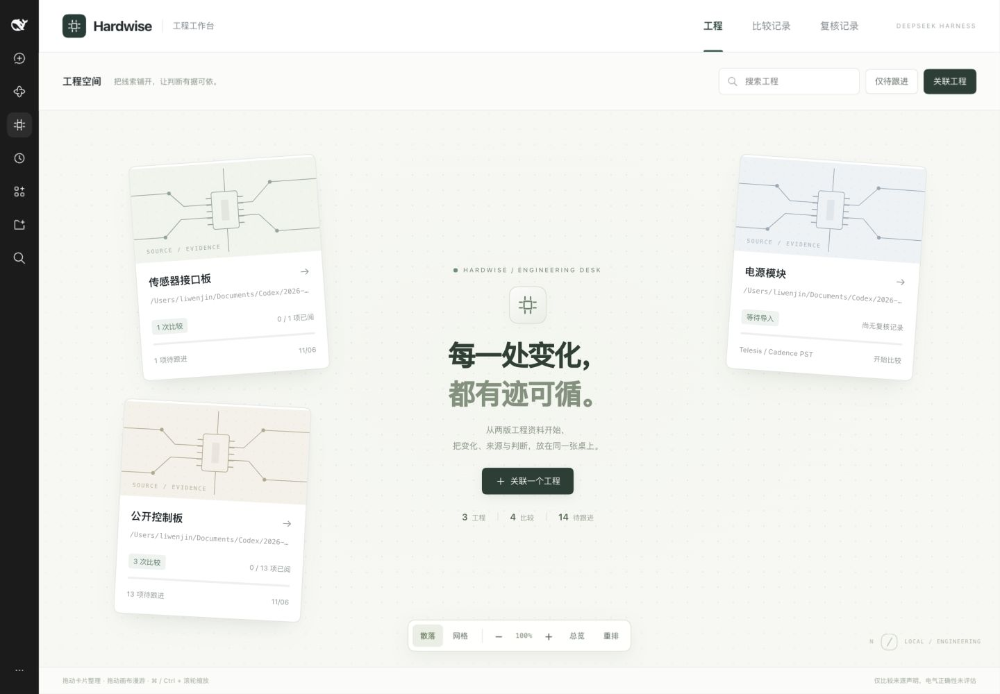
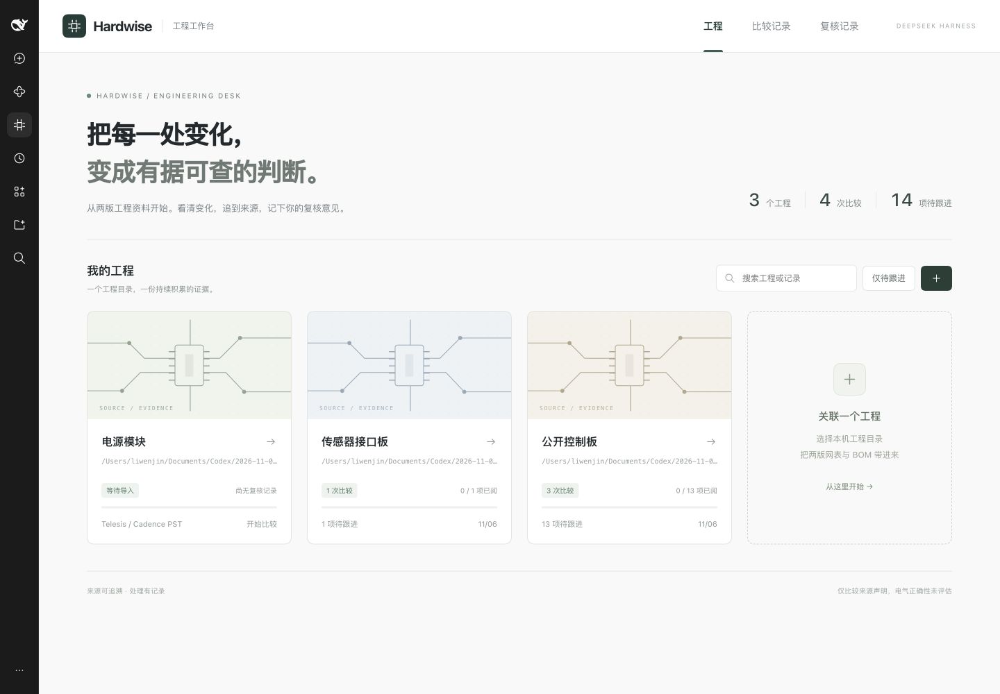
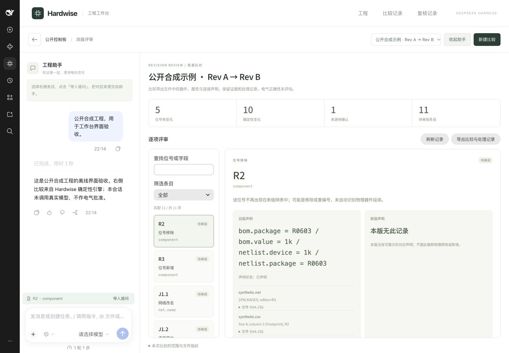

# Hardwise · DSH 独立工程评审工作台

DSH 负责会话和工具编排，Hardwise 负责有来源的工程改版比较、证据展示和本机复核记录。
工作台复用 Hardwise 的确定性引擎，支持两个版本的 Cadence PST 文件组或 Telesis 网表，加 CSV/TSV BOM。



也可以切换到规整网格：




截图仅使用公开合成工程。当前验证范围是 **DSH 0.2.2-rc.1 的本机 Web 配置**。

## 快速安装

从 [Releases](https://github.com/liwenjinchn/dsh-hardwise/releases) 下载 `dsh-hardwise-0.4.0.tgz`，或克隆仓库后执行 `npm run package`。
安装时需要 Python 3.11+；详细步骤见下文。通过 DSH 侧栏「Hardwise 工程工作台」打开，关联本机工程目录后开始比较。

## 已有能力

| 入口 | 行为 |
| --- | --- |
| `hardwise_compare` | 比较两个版本，保存独立记录，在 DSH 显示结果卡片 |
| `hardwise_review_workspace` | 打开本机导入/复核页，列出当前工作目录的最近 100 条记录 |
| `hardwise_get_review` | 重新打开记录、读取最新处理状态，分页读取变更和待确认项 |

DSH 侧栏的「Hardwise 工程工作台」打开独立主面板。工程首页按目录聚合卡片，支持搜索、待跟进筛选、比较记录和复核历史；详情页由工程助手、变化清单、旧版/新版证据和复核表单组成。
助手通过 DSH SessionReference 绑定工程会话，复用原生输入框与会话内容；标准聊天和 DSH 品牌入口保持独立。证据页使用真实 Spectrum 2 React 组件，隔离运行在 iframe 内。
页面支持文件导入、按位号/状态筛选、来源定位与 SHA-256、复核备注、历史记录和 JSON 导出。
状态为“待审阅 / 需补资料 / 已阅”。“已阅”不改变原始来源问题，也不代表电气批准。

## 散落画布首页（0.4）

- 默认散落布局：工程卡片围绕中央入口，带错落入场和悬停效果。
- 拖动卡片整理位置；拖动画布或双指滚动平移；⌘ / Ctrl + 滚轮以指针为中心缩放。底部也提供缩放按钮。
- 「总览」定位当前筛选结果，「重排」恢复默认位置，「网格」切回规整布局。
- 搜索和待跟进筛选使用真实工程记录；点击卡片进入现有评审详情。
- 视图和卡片位置保存在当前浏览器、当前宿主地址的 localStorage，不修改工程文件或复核记录。
- 画布获得键盘焦点后可用方向键平移、加减键缩放、Home 总览；减少动态效果偏好会关闭入场动画。窄窗口可切换网格阅读。

## 安装要求

- 已验证宿主：DSH `0.2.2-rc.1`。版本严格锁定；升级后需重测宿主契约。
- Node 22+（宿主提供）；Python 3.11+。
- Python 最小环境只需 `requirements.txt`，不需要模型 SDK、向量库或原 Hardwise 完整环境。
- 只使用公开或合成硬件输入。

下面以将插件包解压到 `./hardwise-plugin` 为例。先在终端设置一个**绝对路径**的 Python 环境：

```sh
mkdir -p hardwise-plugin
tar -xzf dsh-hardwise-0.4.0.tgz -C hardwise-plugin --strip-components=1
python3 -m venv hardwise-plugin/.venv
hardwise-plugin/.venv/bin/python -m pip install -r hardwise-plugin/requirements.txt
export HARDWISE_PYTHON="$(pwd)/hardwise-plugin/.venv/bin/python"
```

通过 DSH 官方包管理入口安装到独立配置。`DSH_HOME` 需要使用绝对路径；首次启动 web 配置后退出，再安装：

```sh
export DSH_HOME="$(pwd)/hardwise-dsh-home"
dsh web --no-open
# Ctrl-C 退出初始化后的 web 服务
dsh plugin --profile web add /absolute/path/dsh-hardwise-0.4.0.tgz
dsh web
```

从同一终端启动可继承 `HARDWISE_PYTHON`。本版仅支持已验收的 loopback Web 配置（`http://127.0.0.1:<port>`），由已安装的 DSH 启动器运行。Electron 桌面原生 `file://` 界面未接入本版工程桥接，不应视为已支持。
插件卸载使用 `dsh plugin --profile web remove dsh-hardwise`。原始输入和工作目录中的复核记录不随卸载删除。

## 使用

在 DSH 中选择包含输入的工作目录，要求调用 `hardwise_compare`：

```json
{
  "before_netlist": "before/design.net",
  "before_bom": "before/bom.csv",
  "after_netlist": "after/design.net",
  "after_bom": "after/bom.csv",
  "label": "公开工程改版比较"
}
```

PST 格式的网表参数改为目录，该目录需要 `pstxnet.dat`、`pstxprt.dat`、`pstchip.dat`。
所有路径必须处于当前会话工作目录内，单文件上限 10 MiB；不支持越界符号链接。
也可以直接点主工作台“新建比较”，选择四个 Telesis/BOM 文件或八个 PST/BOM 文件；“运行公开合成示例”无需上传文件。先从工程首页选择工程，或用「关联工程目录」注册已存在的本机目录。新工程自动创建 DSH 会话，资料与复核记录保存在对应工程目录内。每个工程列出最近 100 次比较，首页汇总只包含这些记录。

结果卡片在 DSH 的 `Completed → Called tools` 下展开。点击“在 Hardwise 工作台查看证据”，在同一界面选择条目，写明备注后保存。“带入提问”把来源摘录插入原生输入框，保留原草稿，不自动发送。
页面刷新及后端重启可恢复历史；并发保存时检测版本冲突，提示重新读取。
工作台里的旧卡片按 run_id 在当前工程重新打开，不依赖旧服务端口。脱离工作台的独立页旧链接可通过 `hardwise_get_review` 更新。

## 数据和能力边界

- 记录存放在会话工作目录 `.hardwise-dsh/reviews.sqlite3`。每次导入创建新的 `run_id`，复核记录不会串到同内容的另一导入。
- 保存比较快照、来源文件名/定位/哈希和追加式处理历史；不归档原始输入文件，也不做电路仿真、datasheet 验证或签核。
- 处理事件标记 `local_ui`，不声称已认证的人类身份。工具没有“代替人类批准”接口。
- 服务只监听 `127.0.0.1`；私有文件读取接口需要宿主随机令牌；浏览器写入检查来源。它是单机工具，不是多用户服务。
- DSH 工具结果含来源位号和证据；尚未迁移旧 Hardwise Runner 的全局输出 Refdes Guard。任意 DSH 模型自然语言不属于已验证的工程结论，回看原生卡片/来源页核实。
- 原工作台、旧 Copilot、BOM 国产化和 FMEA Skills 没有整体迁入。本版仅实现工程改版比较闭环。
- 已验证离线模拟模型驱动真实 DSH 执行、原生卡片和浏览器持久化；未验证真实模型自主选工具、真实项目验收、完整无障碍或其他 DSH 版本。

## 源码开发与打包

本仓库是可直接构建的独立插件源码快照。`python/hardwise` 随包提供确定性引擎；`client/` 提供浏览器组件源码。

```sh
npm run build
npm run package
```

`npm run package` 将生成可安装 tgz。使用 DSH 官方安装器，不需要把源码目录直接放进宿主内部。
DSH 集成测试需要安装宿主 peer 依赖，并设置 `DSH_RUNTIME` 指向对应版本宿主的 `node_modules`、`HARDWISE_PYTHON` 指向安装过 `requirements.txt` 的 Python：

```sh
DSH_RUNTIME=/absolute/dsh/node_modules HARDWISE_PYTHON=/absolute/venv/bin/python npm test
```

验证范围与限制见 [VALIDATION.md](VALIDATION.md)。

## 视觉来源

内嵌证据页复用官方 Spectrum 2 IIFE 运行包、单份 React 19/ReactDOM 19、对应 CSS 和思源黑体 CN；许可证随 `ui/vendor` 附带。来源快照与 SHA-256 见 `ui/vendor/PROVENANCE.json`。它是候选原型运行包，正式产品构建应改用锁定 npm 依赖。
原生卡片使用 DSH 自带 React，避免将独立页的 React 注入宿主。

## 独立工作台结构

- `client/{kit,canvas,home,assistant,desk,entry}.js` 是浏览器模块源码，`scripts/build_client.py` 拼装为无额外运行依赖的 `client.js`；打包自动重新生成。
- `main[hardwise-desk]` 与 `sidebar.panellist` 提供独立入口，不替换 `main.conversation`。专属 session 子槽由 `SessionProvider` 绑定 retained reference；切换工程或离开面板释放引用与来源上下文。
- `/api/hardwise.projects` 从认证后的 DSH 会话头聚合工程。只读取已存在的 Hardwise 数据库；列举一个空工程不创建数据库。`/api/hardwise.workspace` 仍只接受会话 ID，不信任浏览器传入的目录。
- 复核记录按真实事件数量筛选，包括重新打开为「待审阅」的历史，不用当前状态代替历史。
- 左侧助手的浅色变量取自已安装 DSH 0.2.2-rc.1 的主题契约，仅在助手范围内覆盖，兼容深色宿主。证据 UI 延用包内 Spectrum 2 与字体，见 `ui/vendor/` 的来源说明。

界面组织参考 [dsh-media-desk](https://github.com/woniuniuniu/dsh-media-desk) 的独立工作台与散落首页形式；画布交互为本插件独立实现，没有复制该项目的业务源码。
